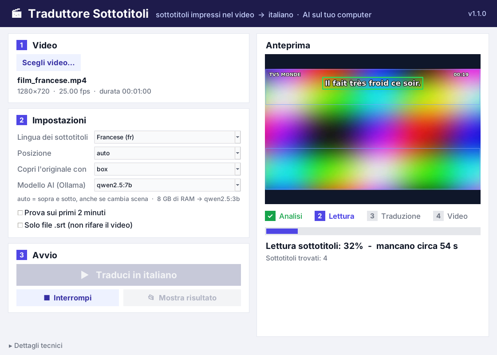
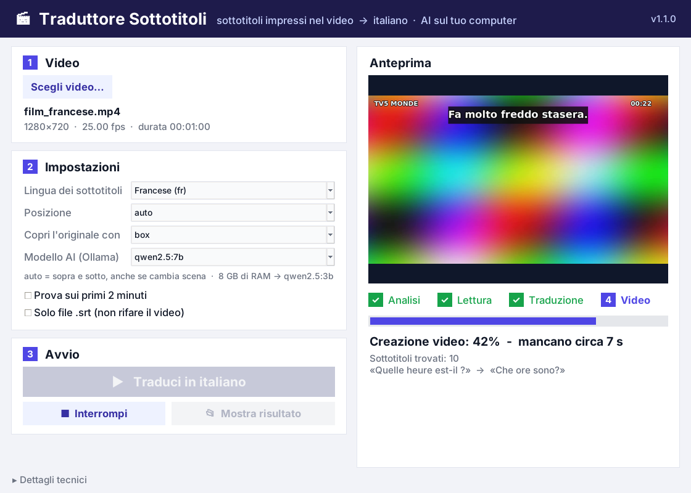
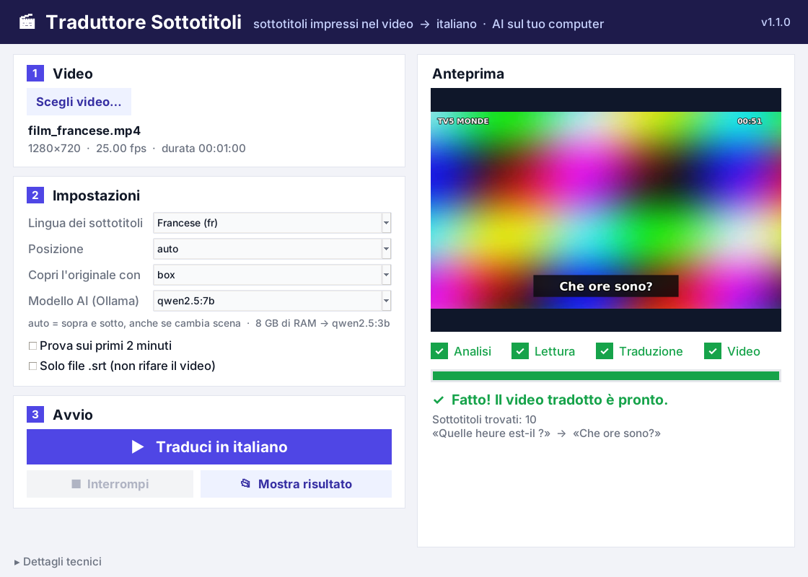

# Traduttore Sottotitoli → Italiano

Traduce in italiano i **sottotitoli impressi nel video** (quelli "stampati" nell'immagine, non un file `.srt`), tutto **in locale** con un'AI sul tuo computer.


1. Trova da solo i sottotitoli: in basso, in alto, oppure che **cambiano posizione da scena a scena** (anche sopra e sotto nello stesso momento). Ignora loghi, orologi e scritte negli angoli.
2. Li legge con l'OCR: su **Mac** quello di sistema (Apple Vision, veloce e preciso); su Windows/Linux EasyOCR.
3. Li traduce con un'AI locale ([Ollama](https://ollama.com), modello `qwen2.5:7b`), correggendo anche gli errori di lettura.
4. Crea un **nuovo video** con i sottotitoli originali coperti e quelli italiani al loro posto, con l'audio originale. Salva anche il file `.srt` italiano.

Pensato anche per **film interi (2 ore e oltre)**: stima il tempo necessario, mostra quanto manca, e se lo interrompi (o si spegne il computer) riparte da dove era rimasto.

---

## Mac: scarica l'app

Vai su **[Releases](../../releases)** e scarica:

| Il tuo Mac | File |
|---|---|
| Apple Silicon (M1, M2, M3, M4…) | `TraduttoreSottotitoli-macOS-apple-silicon.dmg` |
| Intel | `TraduttoreSottotitoli-macOS-intel.dmg` |

(Non sai quale? Menu  → *Informazioni su questo Mac*: se c'è scritto "Chip Apple M…" è Apple Silicon.)

Apri il `.dmg` e trascina l'app in **Applicazioni**.

**Prima apertura.** L'app non è firmata da Apple, quindi macOS la blocca la prima volta:
- macOS 15 (Sequoia) e successivi: prova ad aprirla, poi *Impostazioni di Sistema → Privacy e sicurezza* → in basso **"Apri comunque"**.
- macOS 12–14: **clic destro sull'app → Apri → Apri**.
- In alternativa, da Terminale:
  ```bash
  xattr -dr com.apple.quarantine "/Applications/Traduttore Sottotitoli.app"
  ```

**Serve anche Ollama** (l'AI che traduce): scaricalo da [ollama.com/download](https://ollama.com/download) e installalo. Non serve altro: l'app lo avvia da sola e **scarica il modello AI automaticamente al primo uso** (circa 4,7 GB, una volta sola). Con un Mac da 8 GB di RAM scegli il modello `qwen2.5:3b`, più leggero.

Requisiti: macOS 12 o successivo (la versione minima esatta di ogni build è indicata nella pagina della release). Funziona sia su Mac Intel che Apple Silicon: su Apple Silicon è molto più veloce.

## Windows

1. Installa [Python 3.10+](https://www.python.org/downloads/) (spunta **"Add Python to PATH"**).
2. Scarica questo progetto (*Code → Download ZIP*) ed estrailo.
3. Doppio clic su `INSTALLA_Windows.bat` (una volta sola: installa tutto, Ollama compreso).
4. Doppio clic su `AVVIA_Windows.bat`.

## Linux / Mac da sorgente

```bash
./installa_mac_linux.sh
```
```bash
./avvia_mac_linux.sh
```

---

## Come si usa



1. **Scegli** il video.
2. Imposta la **lingua** dei sottotitoli (es. `fr - francese`).
3. Consigliato la prima volta: spunta **"Prova solo sui primi 2 minuti"** per controllare il risultato in fretta.
4. Premi **▶ Traduci in italiano**. Durante il lavoro l'anteprima mostra i sottotitoli trovati (riquadro verde) e poi i fotogrammi già tradotti; sotto vedi la fase, il tempo che manca e l'ultima frase tradotta.
5. Alla fine **📂 Mostra risultato** apre la cartella con il video tradotto.

<p align="center"> </p>

Accanto al video originale trovi:

| File | Contenuto |
|---|---|
| `nomevideo_ITA.mp4` | il video con i sottotitoli in italiano |
| `nomevideo_ITA.srt` | i sottotitoli italiani (file separato) |
| `nomevideo_originale.srt` | il testo originale letto dall'OCR |

### Opzioni della finestra

- **Posizione**: `auto` (consigliato: controlla sia sopra che sotto), oppure solo `basso` / `alto` (più veloce).
- **Copri originale con**: `box` (fascia scura, il più pulito), `inpaint` (ricostruisce lo sfondo), `sfoca`.
- **Solo .srt**: non rifà il video, crea solo i sottotitoli.

### Da riga di comando

```bash
python traduci_sottotitoli.py film.mp4 --lingua fr
```
```bash
python traduci_sottotitoli.py film.mp4 --lingua en --prova 120 --modo inpaint
```

Tutte le opzioni: `python traduci_sottotitoli.py --help` (`--posizione`, `--modello`, `--ocr`, `--intervallo`, `--conf`, `--zona`, `--solo-srt`, `--prova`…).
L'app Mac accetta gli stessi argomenti: `"/Applications/Traduttore Sottotitoli.app/Contents/MacOS/Traduttore Sottotitoli" film.mp4 --lingua fr`.

## Video lunghi

- All'inizio fa un'analisi veloce e mostra una **stima del tempo**; durante il lavoro la barra mostra quanto manca.
- **Interrompi** quando vuoi (anche chiudendo la finestra): i progressi sono salvati in `nomevideo_ITA_progresso.json`. Rilanciando lo stesso video con le stesse impostazioni **riparte da dove era**.
- Ollama e il modello vengono controllati **subito**, non dopo un'ora di lavoro.
- Lascia il computer acceso (disattiva la sospensione) durante i film lunghi. Su Mac Apple Silicon è molto più veloce che su PC senza scheda video NVIDIA.

## Se qualcosa va storto

Il programma si ferma con un messaggio chiaro invece di dare un risultato sbagliato:

| Messaggio | Cosa fare |
|---|---|
| *Ollama non risponde* | installa/apri Ollama e rilancia (il lavoro è salvato) |
| *download del modello fallito* | controlla la connessione e il nome del modello |
| *file danneggiato* | converti il video in MP4 (es. con HandBrake) e riprova |
| *Nessun sottotitolo trovato* | prova `--conf 0.2` oppure `--zona 0.5` |

**Limiti:** i sottotitoli devono essere più o meno centrati (le scritte negli angoli vengono ignorate apposta). Con video a frame rate variabile (registrazioni da telefono/schermo) l'audio può slittare leggermente: convertili prima in MP4 a fps fisso.

---

## Per sviluppatori

- `traduci_sottotitoli.py`: tutto il programma (GUI Tkinter + riga di comando).
- `docs/genera_screenshot.py`: rigenera le immagini di questo README usando l'app vera (Linux: `xvfb-run -s "-screen 0 1120x800x24" python docs/genera_screenshot.py`).
- `tests/test_completo.py`: test end-to-end. Crea un video con sottotitoli francesi che cambiano posizione, un logo e un orologio, usa un finto Ollama (che parte senza modello, per provare anche il download) e controlla frase per frase posizione e tempi.
- `build_mac.sh`: crea `Traduttore Sottotitoli.app` con PyInstaller per l'architettura del Mac in uso.
- `.github/workflows/build-macos.yml`: per ogni push compila e **prova l'app compilata** su Mac Intel e Apple Silicon; con un tag `v*` pubblica la release con `.dmg` e `.zip`.

Per pubblicare una nuova release (con `.dmg` per Intel e Apple Silicon):
- **dal sito GitHub:** scheda *Actions* → *Build macOS (Intel + Apple Silicon)* → *Run workflow* → scrivi la versione (es. `v1.1.0`) → *Run workflow*;
- **oppure da terminale**, con un tag:

```bash
git tag v1.1.0
```
```bash
git push origin v1.1.0
```
